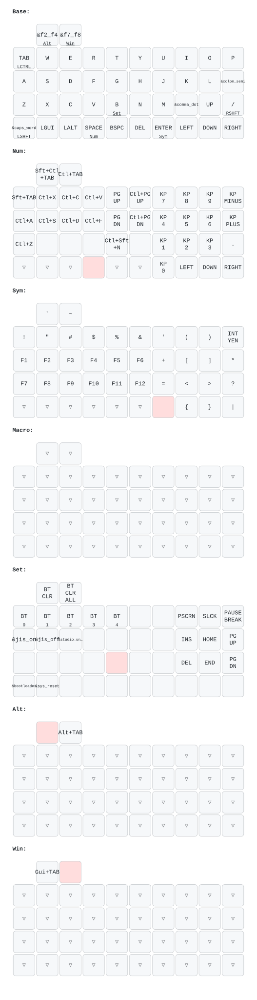

# Enigma_01 ファームウェア（キーマップ）

Enigma_01 のファームウェアとキーマップです。総合案内とビルドガイドは[こちら](https://github.com/nazuna293/Enigma_01)です。

## 2つの版

| 版 | ブランチ | キーマップを画面で変える | 中身 |
|:-|:-|:-|:-|
| **DYA 版**（初期） | `dya` | [DYA Studio](docs/DYA_Studio.md) でキーの割り当て・レイヤー・**同時押し・マクロ**まで。[ZMK Studio](docs/ZMK_Studio.md) も使える | cormoran さんの ZMK と、同時押し・マクロを画面で編集するモジュール |
| **公式版** | `zmk-main` | [ZMK Studio](docs/ZMK_Studio.md)・[DYA Studio](docs/DYA_Studio.md) でキーの割り当てとレイヤー | 公式の ZMK |

キーの並び（初期キーマップ）は、2つの版で同じです。ファームは [Releases](https://github.com/nazuna293/zmk-Enigma_01-user-config/releases) からダウンロードできます（1.0u 配列のもの。1.5u・2.0u 配列は、書き込んだあと Studio で物理配置を切り替えます）。

## 初期キーマップ

ほかの配列の図は[こちら](docs/keymap.md)です。

### レイヤー
| 番号 | 名前 | 入り方 | 中身 |
|:-:|:-|:-|:-|
| 0 | Base | ― | 文字 |
| 1 | Num | Space を押している間 | 数字・Ctrl の近道（コピー・貼り付けなど）・PageUp/Down |
| 2 | Sym | Enter を押している間 | 記号・F1〜F12 |
| 3 | Macro | BS＋Enter の同時押し | 空き。Studio で自由に割り当てる |
| 4 | Set | B を押している間 | Bluetooth・US/JIS の切り替え・Studio のロック解除・書き込みモード |
| 5 | Alt | 左上のキーを押している間 | 右上で Alt+Tab |
| 6 | Win | 右上のキーを押している間 | 左上で Win+Tab |

### 1つのキーに2つの役割があるもの
| キー | タップ | 2回タップ | 押している間 |
|:-|:-|:-|:-|
| 左上 | F2 | F4 | Alt のレイヤー（右上で Alt+Tab） |
| 右上 | F7 | F8 | Win のレイヤー（左上で Win+Tab） |
| Q の位置 | Tab | ― | Ctrl |
| L の右 | `:` | `;` | ― |
| M の右 | `,` | `.` | ― |
| ↑ の右 | `/` | ― | 右 Shift |
| 左下 | Caps Word | ― | Shift |
| B | B | ― | Set のレイヤー |

### 同時押し（Base）
| 押すキー | 出る文字 |
|:-|:-|
| Tab＋W | Q |
| 左上＋Tab | Esc |
| I＋O | `-` |
| O＋P | `^` |
| L＋`:` | `@` |
| ↑＋`/` | `_` |
| K＋L | Delete |
| A＋Space | 無変換（IME オフ） |
| `:`＋Enter | 変換（IME オン） |
| BS＋Enter | Macro のレイヤー |

Num のレイヤーでは、さらに `/` `*` `=` Enter の同時押しがあります。

## US 配列と JIS 配列
キーマップは US 配列のキーで書いてあり、JIS 配列のパソコンでは記号の位置を合わせて送ります（[layout-shift](https://github.com/kot149/zmk-layout-shift)）。切り替えは、B を押したまま **A の位置で JIS**、**S の位置で US** です。JIS 配列のパソコンでは、最初に一度 JIS に切り替えてください。切り替えた状態は、電源を切っても残ります。

## キーマップを変える
| 方法 | 向いている人 | 変えられるもの | 必要なもの |
|:-|:-|:-|:-|
| [DYA Studio](docs/DYA_Studio.md) | はじめての人（おすすめ） | DYA 版: キーの割り当て・レイヤー名・同時押し・マクロ／公式版: キーの割り当て・レイヤー名 | Chrome か Edge |
| [ZMK Studio](docs/ZMK_Studio.md) | はじめての人 | キーの割り当て・レイヤー名 | ブラウザかアプリ |
| [キーマップのファイルを直接直す](docs/Edit_keymap.md) | 慣れた人 | すべて（ビヘイビアの細かい設定・タイミングなど） | GitHub のアカウント |

Studio で変えた内容は、キーボード本体に保存されます。
