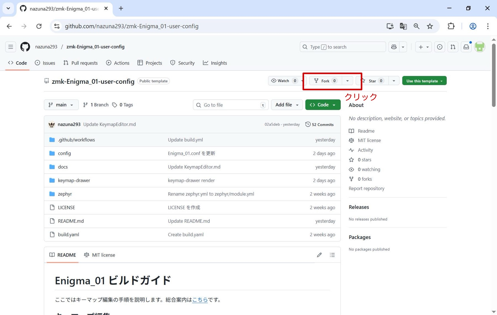
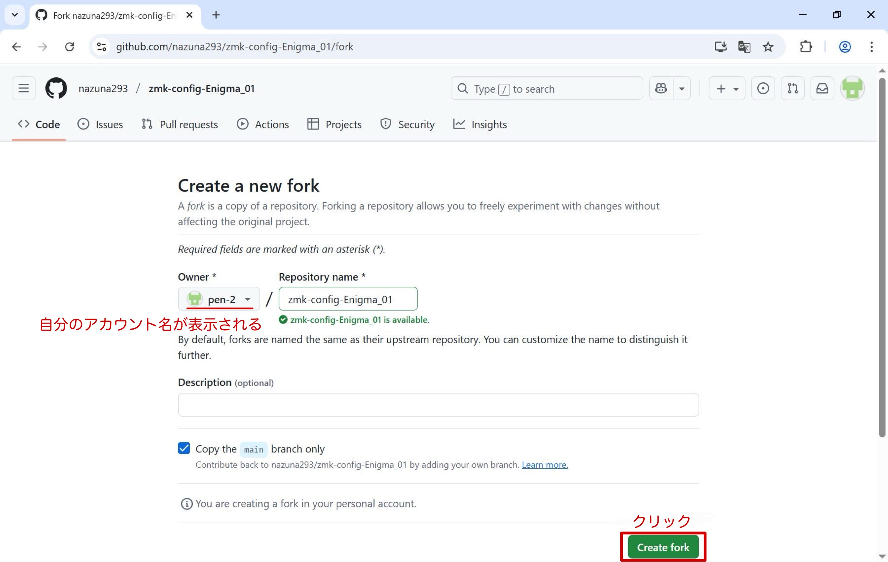
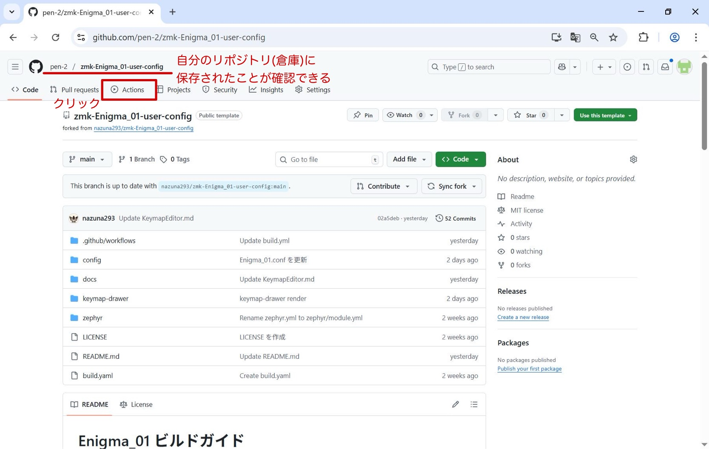
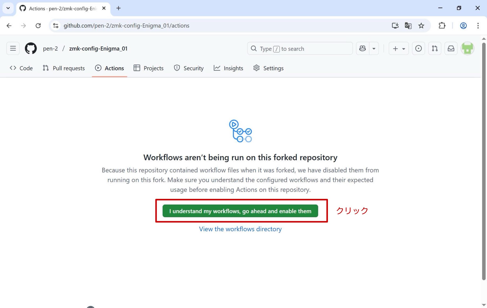
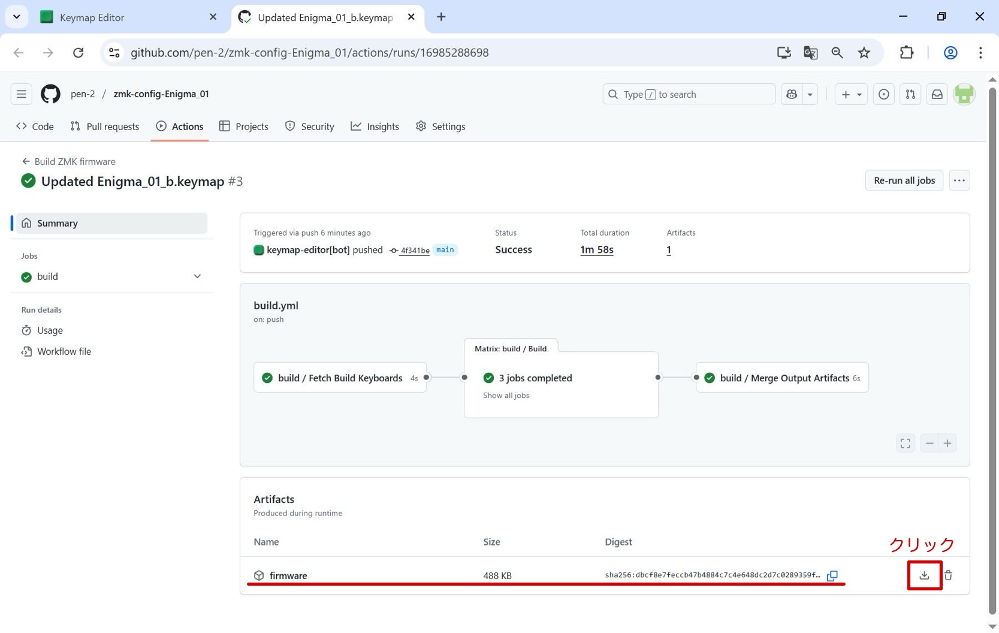
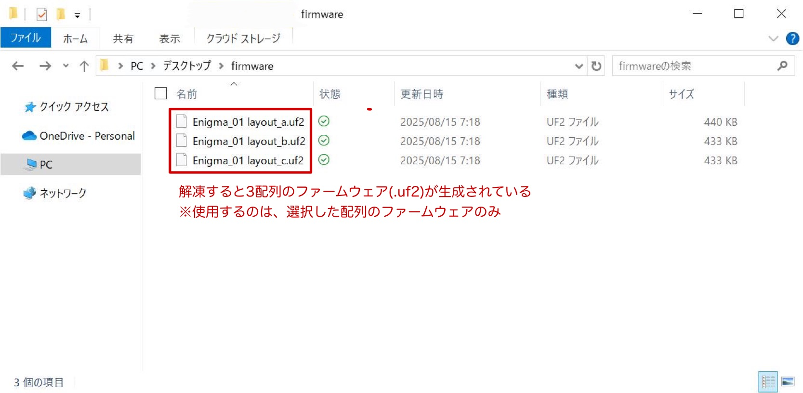
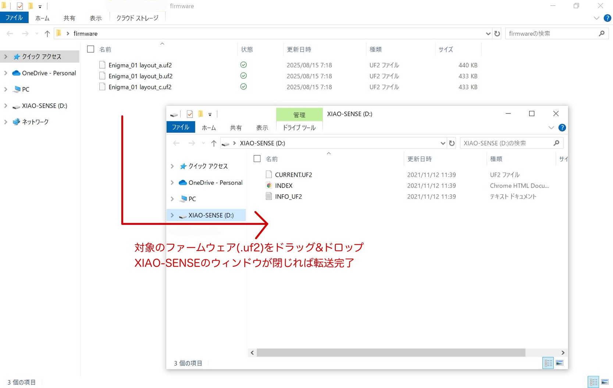

# キーマップのファイルを直接直す（慣れた人向け）

ビヘイビアの細かい設定（タップと長押しの判定時間など）まで変えたい人向けです。自分の GitHub のリポジトリでキーマップのファイルを直し、GitHub Actions でファームを作ります。キーの割り当てを変えるだけなら、[DYA Studio](DYA_Studio.md) か [ZMK Studio](ZMK_Studio.md) の方が簡単です。

## 1. リポジトリをフォークする
1. GitHubアカウントを持っていない場合は、事前に[アカウント登録](https://github.com/signup)をしてください。  
2. このリポジトリを[フォーク](https://github.com/nazuna293/zmk-Enigma_01-user-config/fork)します。使う版のブランチ（DYA 版は `dya`、公式版は `zmk-main`）も一緒にコピーされるよう、「Copy the ○○ branch only」のチェックは外してください。

## 2. ファイルを直す
`config/` の中のファイルを、GitHub の画面（鉛筆のボタン）で直します。

| ファイル | 中身 |
|:-|:-|
| `Enigma_01_common.dtsi` | 3つの配列で共通の部分。ビヘイビア（タップと長押しの判定時間など）、マクロ、US/JIS の設定 |
| `Enigma_01_a.keymap`（1.0u）／`_b`（1.5u）／`_c`（2.0u） | 配列ごとのキーの割り当て（レイヤー）と、同時押しの位置 |
| `Enigma_01_variant.dtsi` | 版ごとに違う部分（同時押しの作り方）。ふつうは直さない |
| `Enigma_01.conf` | 電源・スリープ・LED などの設定 |

- 同時押しは `COMBO(名前, 割り当て, 押すキーの番号, レイヤー)` の1行で書きます。キーの番号は、各 .keymap の先頭の説明にあります
- 書き方は ZMK の [Behaviors](https://zmk.dev/docs/keymaps/behaviors)・[Keycodes](https://zmk.dev/docs/keymaps/list-of-keycodes) のページに載っています

## 3. ファームを作る
1. リポジトリの「Actions」で「Build ZMK firmware」を選び、使う版のブランチを選んで「Run workflow」を押します
2. 終わったら、実行結果の「Artifacts」から firmware の zip をダウンロードして、解凍します

Artifacts は、一定の期間（初期設定では90日）で消えます。必要なファームは手元に保存しておいてください。

## 4. 書き込む
1. Enigma_01とパソコンをUSB-Cケーブルで接続します。
2. リセットボタンを2回押します（または、B を押したまま最下段の左端＝bootloader を押します）。
3. 「XIAO SENSE」などのドライブが表示されたら、自分の配列のファームウェア(.uf2)をコピーします。

|ファームウェア(.uf2)|配列|  
|:-|:-|  
|Enigma_01 layout_a|1.0u配列|  
|Enigma_01 layout_b|1.5u配列|  
|Enigma_01 layout_c|2.0u配列|  

有線ならそのまま使えます。Bluetooth でつながらなくなったときは、パソコン側の登録を消し、B を押したまま 左上のキー（`BT_CLR`）を押してから、ペアリングし直してください。

---

[← キーマップ編集の案内に戻る](../README.md#キーマップを変える)
