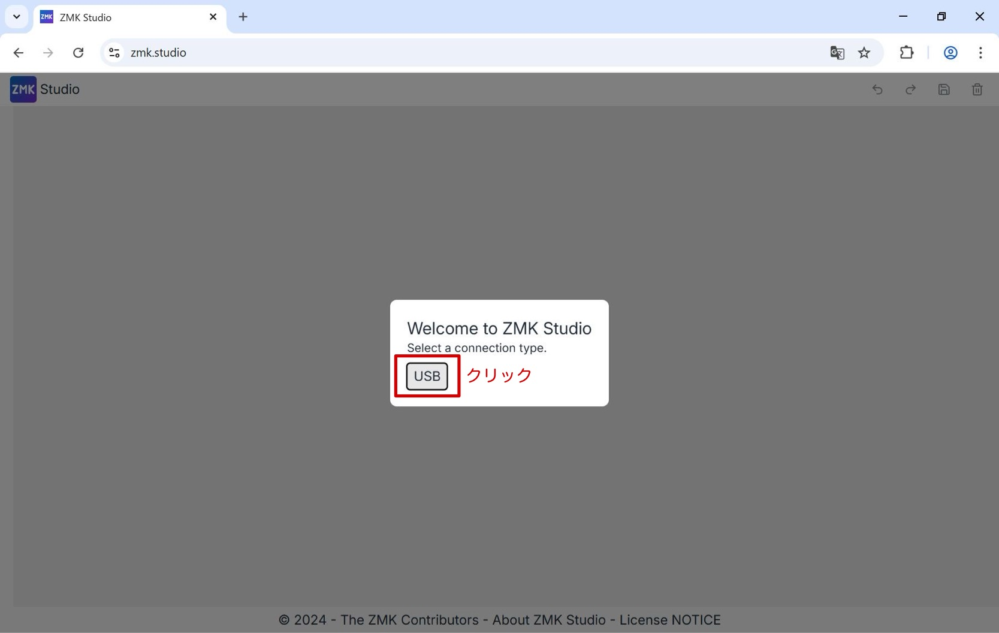
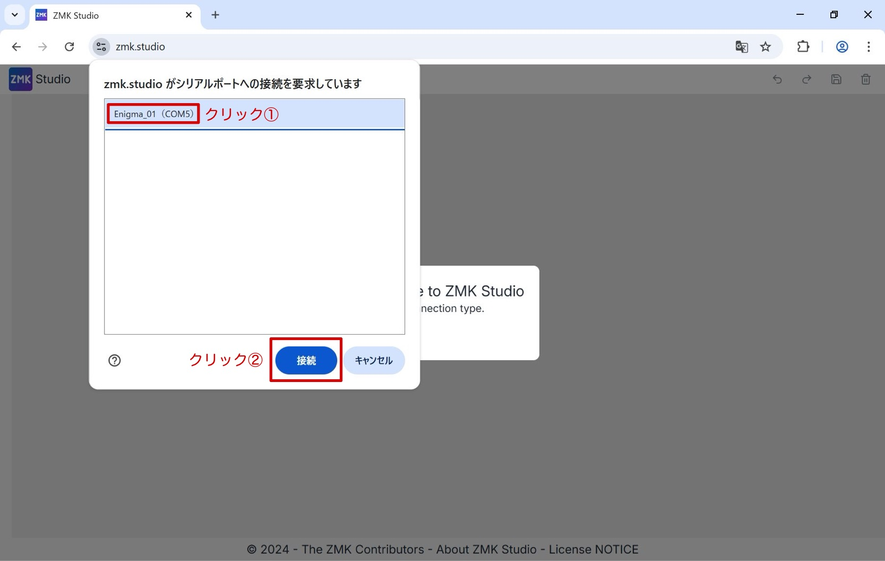
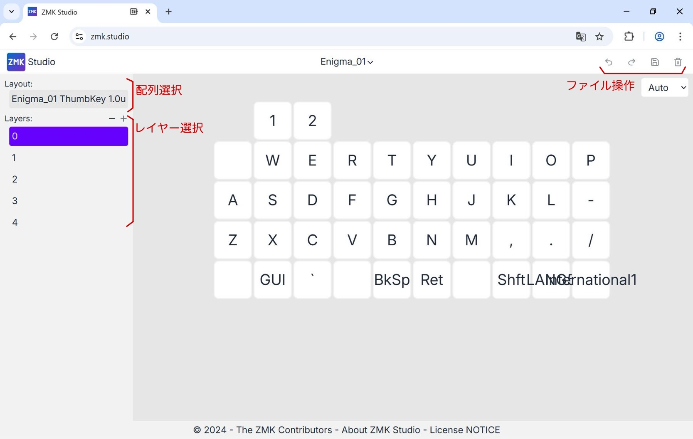
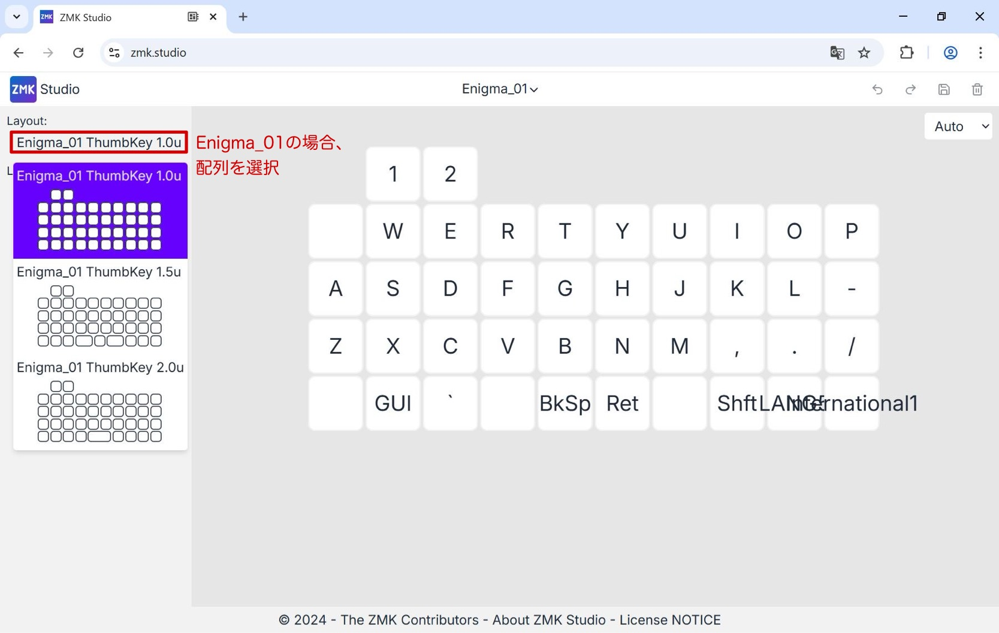
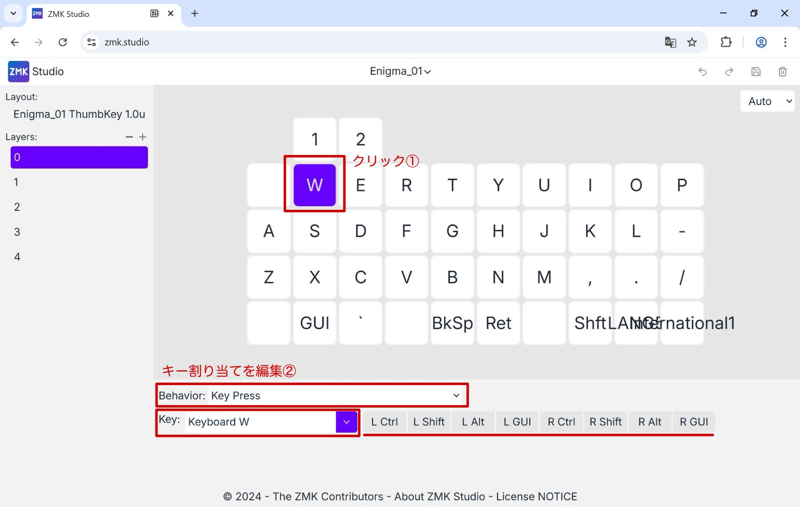
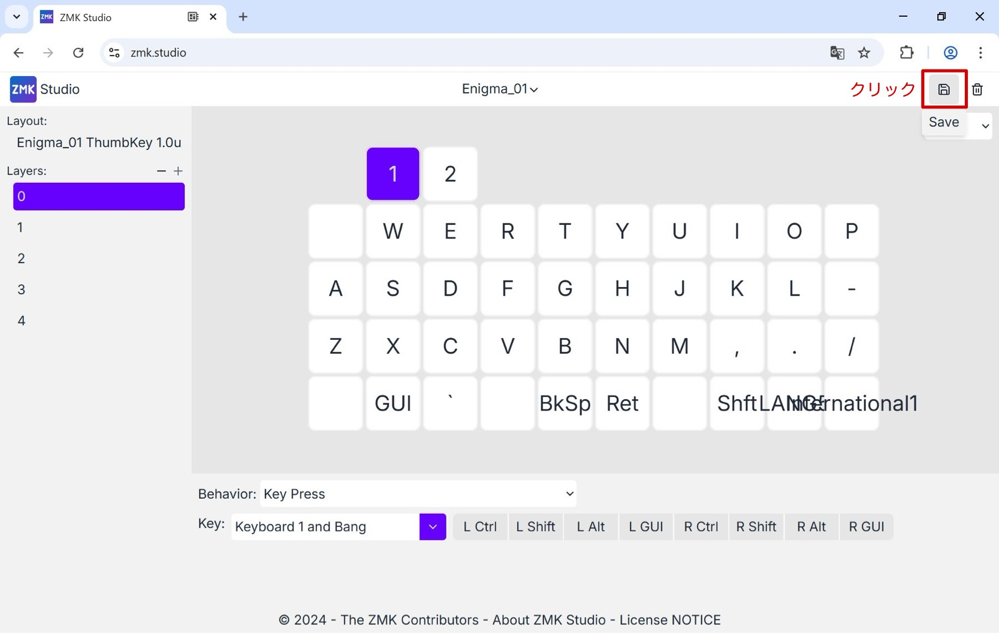
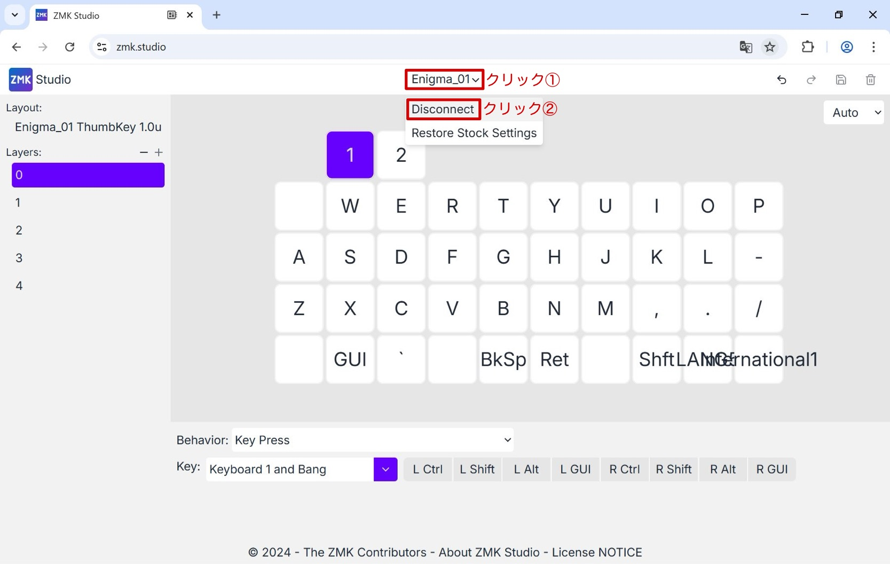

# ZMK Studio

公式の ZMK Studio で、キーの割り当てとレイヤー名を変えます（DYA 版・公式版のどちらでも使えます）。同時押し・マクロを変えたいときは [DYA Studio](DYA_Studio.md)（DYA 版）を使います。

## ブラウザ上で接続
1. Enigma_01とパソコンをUSB-Cケーブルで接続します。
2. ブラウザ上で[ZMK Studio](https://zmk.studio)を開きます（Chrome・Edge）。アプリ版は[こちら](https://zmk.studio/download)です。

3. Enigma_01を選択して接続します。

4. 「ロックされている」と表示されたら、Enigma_01 で **B を押したまま、D の位置（studio_unlock）** を押してロックを解除します。

## キーマップの編集  
1. ブラウザ上でレイアウトを選択します（1.0u／1.5u／2.0u。1.0u のファームを書き込んだ 1.5u・2.0u の人は、ここで自分の配列に切り替えます）。

2. 各キーを選択して編集します。

3. 編集を保存します。

- Macro のレイヤー（3）は空けてあります。自分用の割り当てに使ってください
- 同時押しは、ZMK Studio では変えられません（ZMK Studio が未対応）

## 接続解除  
1. Enigma_01の接続を解除してwebページを閉じます。

---

[← キーマップ編集の案内に戻る](../README.md#キーマップを変える)
